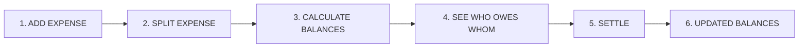
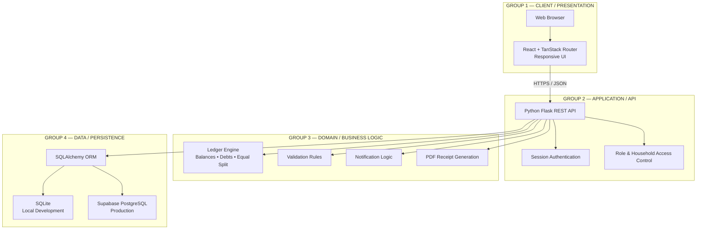
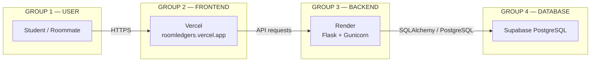
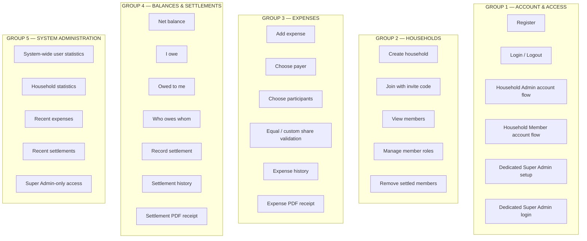
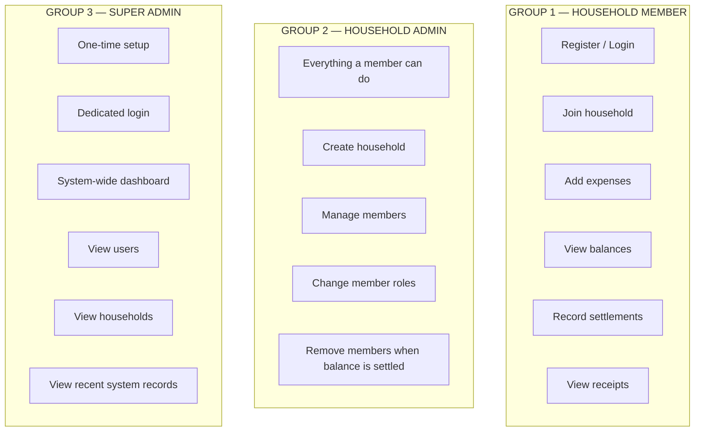
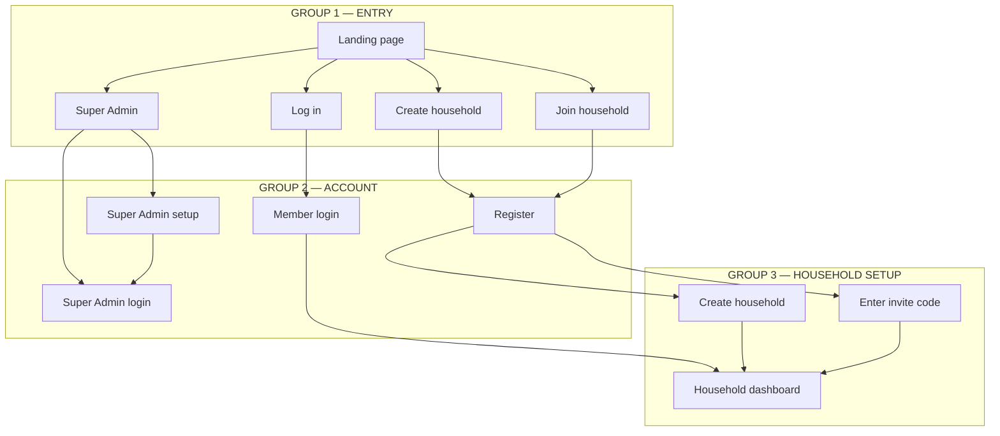
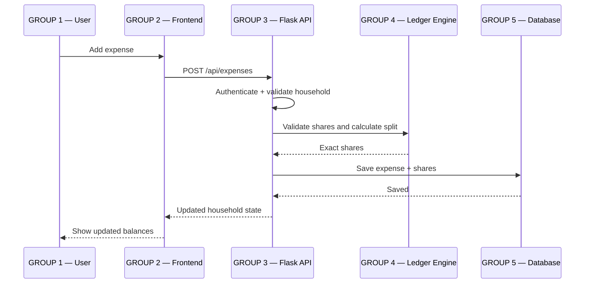
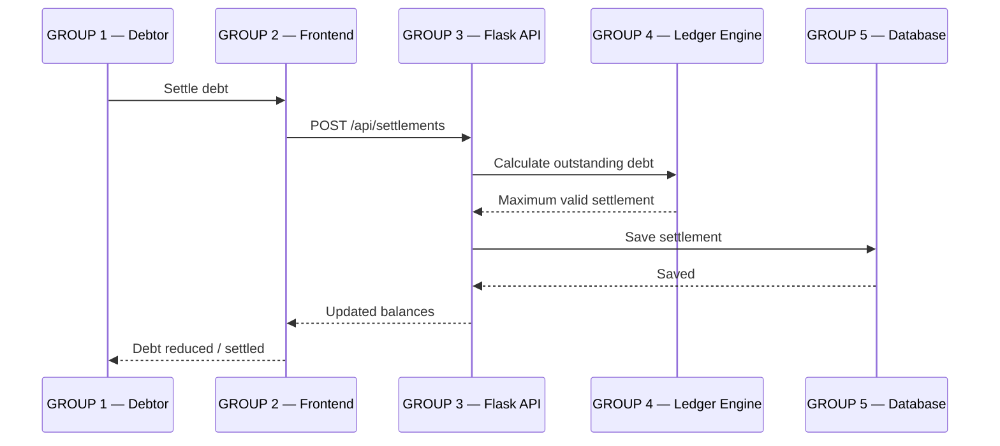
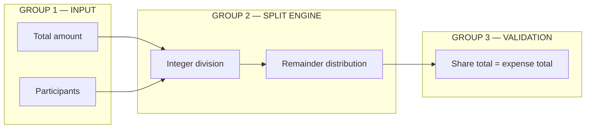
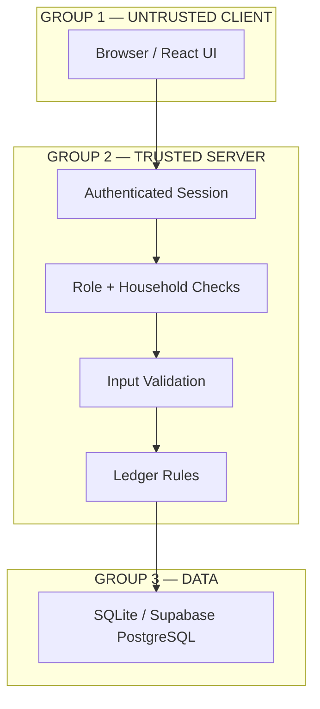

# Roommate Ledger

Roommate Ledger is a web-based shared dorm expense splitter for roommates to record groceries, utilities and other household expenses, calculate exact shares, see who owes whom, and record settlements.

> **Project scope:** This is an expense-sharing system, not a bank. There is no wallet, deposit, withdrawal, loan or artificial account balance.

## 1. Core workflow



## 2. System architecture



## 3. Production deployment architecture



## 4. Main features



## 5. User roles



**Important:** Super Admin is not a selectable normal household account and should not use the ordinary member login.

## 6. Authentication and onboarding flow



A visitor does **not** need to log in before choosing **Create household**. If they are not authenticated, the app sends them through registration first; the server then authenticates the new account before creating the household. This preserves secure ownership without forcing an unnecessary login-first dead end.

## 7. Expense and settlement design





## 8. Balance formula

For each household member:

`Net Balance = Amount Paid - Individual Shares + Settlements Sent - Settlements Received`

- **Positive:** the household owes this person.
- **Negative:** this person owes the household.
- **Zero:** settled.

Example:

- Wura pays ₦40,000.
- Wura, Tolu, Ada and John participate.
- Equal share = ₦10,000 each.
- Wura's net = ₦40,000 − ₦10,000 = **+₦30,000**.
- Tolu, Ada and John each have **−₦10,000**.

## 9. Exact splitting



For ₦10,000 shared by three people:

**₦3,334 + ₦3,333 + ₦3,333 = ₦10,000**

The system stores money in **kobo** to avoid floating-point calculation errors.

## 10. Security boundaries



The browser is never the source of truth for authentication, balances, permissions or household ownership. The Flask server validates protected operations.

## 11. Local development

### Frontend

```bash
npm install
npm run dev
```

### Backend

```bash
cd backend
python3.11 -m venv .venv
source .venv/bin/activate
pip install -r requirements.txt
python run.py
```

Local API:

`http://localhost:5000`

Health endpoint:

`http://localhost:5000/api/health`

Frontend environment:

```env
VITE_API_URL=http://localhost:5000/api
```

### Production environment

Frontend:

```env
VITE_API_URL=https://build-it-better-main.onrender.com/api
```

Backend on Render:

```env
DATABASE_URL=<Supabase Session Pooler connection string>
FLASK_SECRET_KEY=<long random secret>
FRONTEND_ORIGIN=https://roomledgers.vercel.app
COOKIE_SECURE=true
```

Never commit `.env`, production database credentials, or secret keys.

## 12. Documentation

- `docs/SRS.md` — software requirements
- `docs/architecture.md` — architectural design
- `docs/database-design.md` — database design
- `docs/functional-requirements.md` — functional requirements
- `docs/non-functional-requirements.md` — non-functional requirements
- `docs/security-and-rbac.md` — security and role access
- `docs/deployment.md` — deployment
- `docs/user-manual.md` — user guide
- `docs/testing.md` — testing
- `docs/diagrams.md` — Mermaid diagrams
- `docs/requirements-traceability.md` — requirements traceability
- `docs/SDLC.md` — software development lifecycle

## 13. Project structure

```text
.
├── src/                    # React + TanStack frontend
│   ├── routes/             # Application pages and flows
│   ├── components/         # Reusable UI
│   └── lib/                # Client ledger helpers and API state
├── backend/
│   └── app/
│       ├── routes.py       # Flask API
│       ├── models.py       # SQLAlchemy models
│       ├── ledger.py       # Balance and split logic
│       └── __init__.py     # Application factory
├── docs/                   # Software engineering documentation
└── public/                 # Static assets
```
