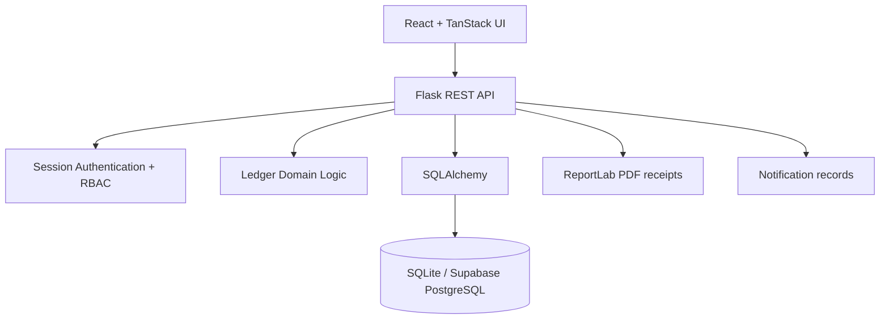

# Architectural Design

## Layered architecture

### Presentation layer
React/TanStack routes handle navigation, forms, dashboards and user feedback.

### Application/API layer
Flask exposes authentication, household, expense, settlement, notification and Super Admin endpoints.

### Domain layer
`ledger.py` performs balance, pairwise debt and exact split calculations.

### Persistence layer
SQLAlchemy maps users, households, memberships, expenses, shares, settlements and notifications to relational tables.

### Security boundary
The browser is untrusted. The backend determines the authenticated user from the session and validates household membership and roles before every protected mutation.
