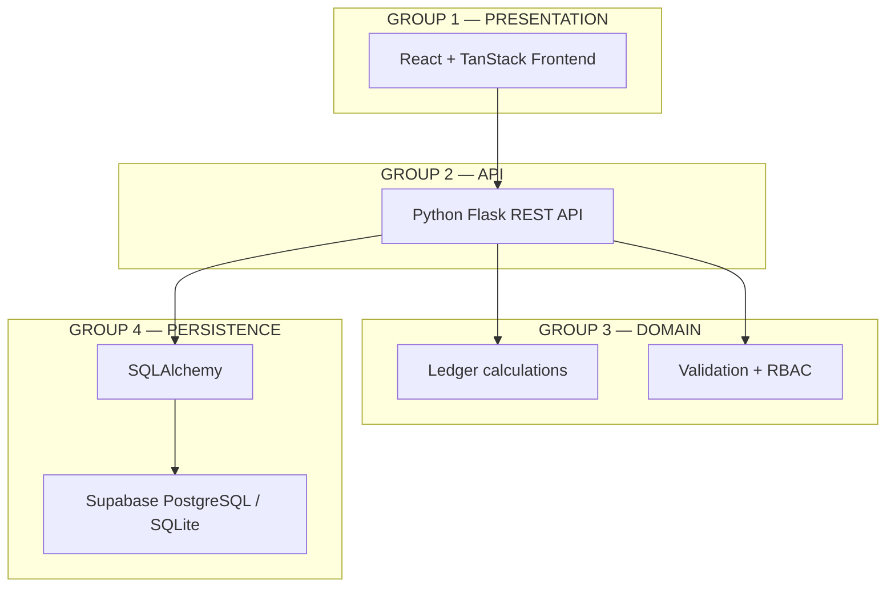
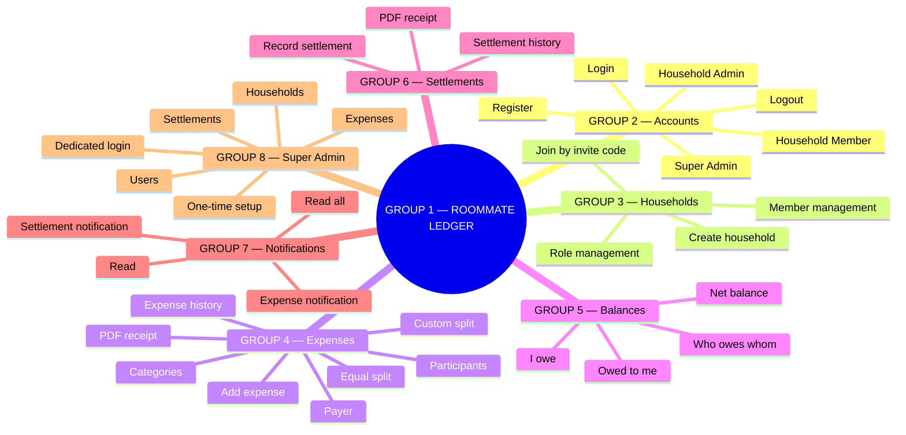
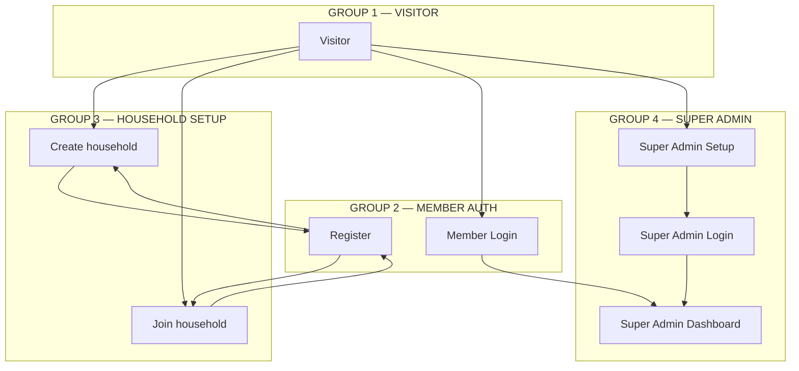
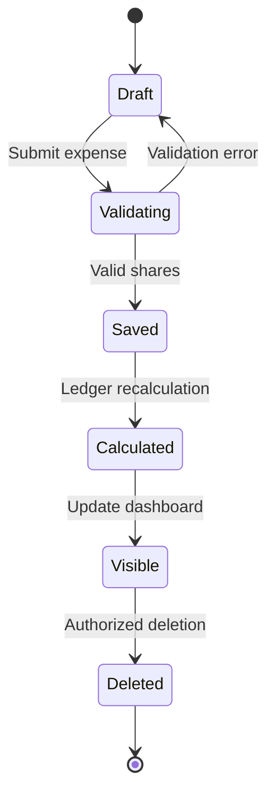
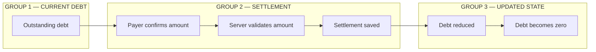
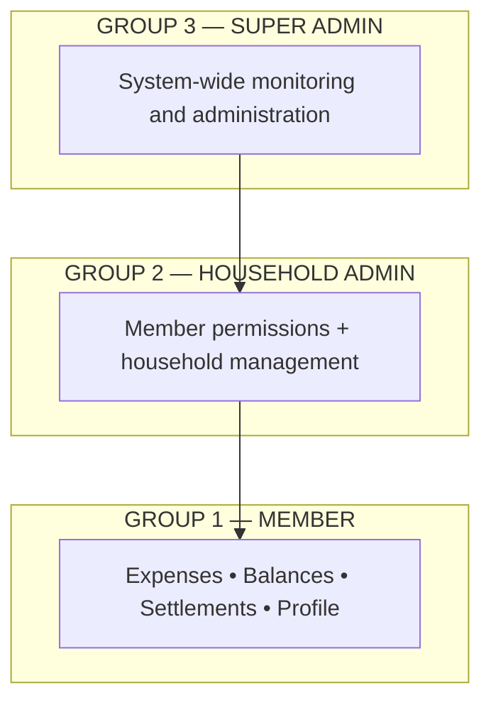
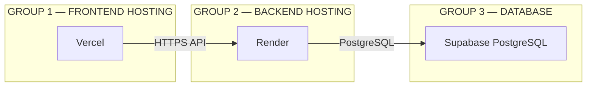
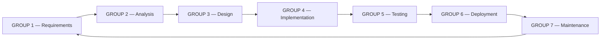

# Roommate Ledger — Mermaid Design Diagrams

These diagrams describe the implemented Roommate Ledger system. The group labels identify the major architectural or feature areas.

## 1. System architecture

## 2. Feature map

## 3. Authentication flow

## 4. Expense lifecycle

## 5. Settlement lifecycle

## 6. Role access model

## 7. Deployment

## 8. SDLC

